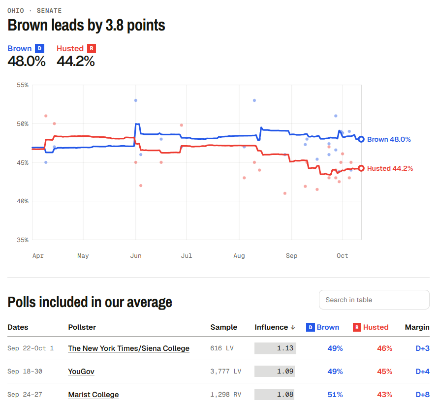
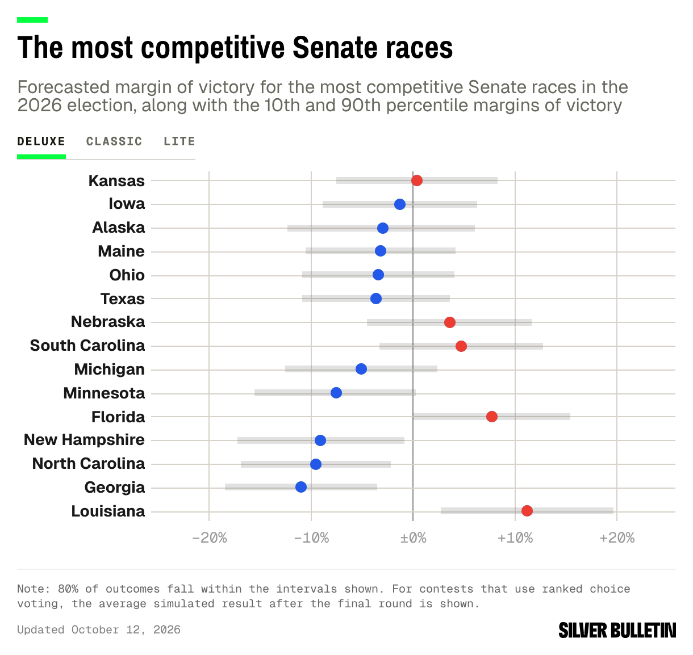
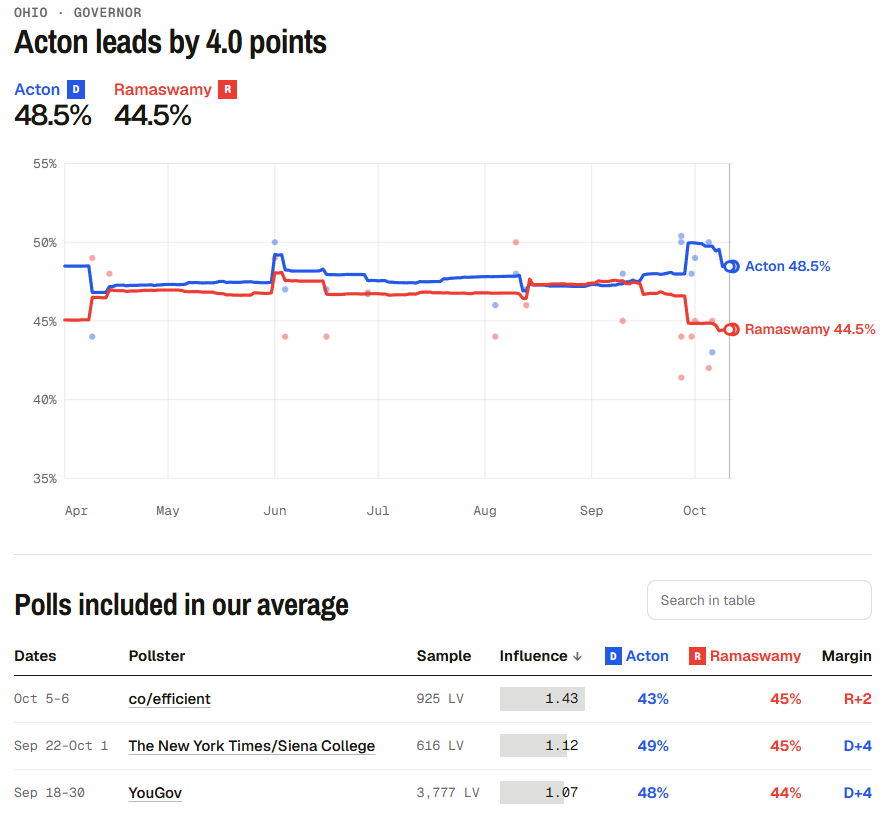
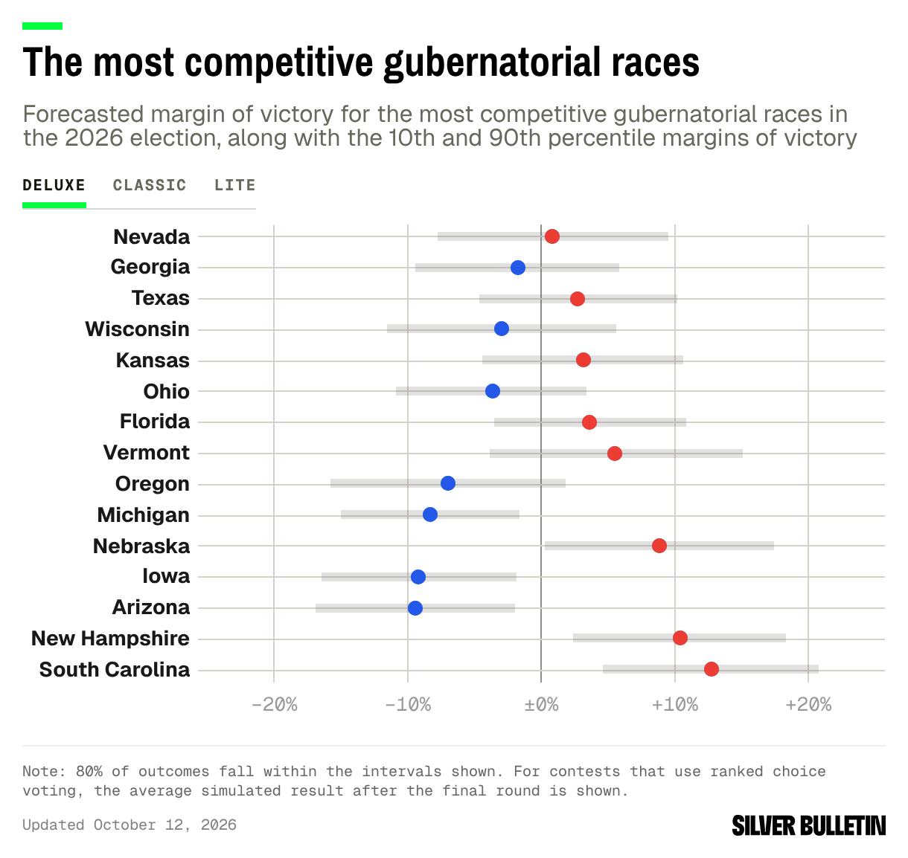
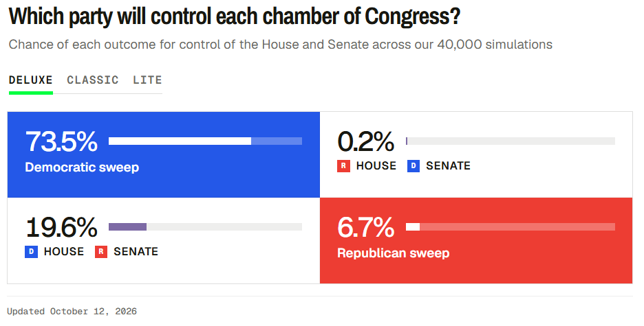

# 431 Class 15: 2026-10-13

[Main Website](https://thomaselove.github.io/431-2026/) | [Calendar](https://thomaselove.github.io/431-2026/calendar.html) | [Syllabus](https://thomaselove.github.io/431-syllabus-2026/) | [Book](https://thomaselove.github.io/431-book/) | [Contact Us](https://thomaselove.github.io/431-2026/contact.html) | [Canvas](https://canvas.case.edu) | [Data and Code](https://github.com/THOMASELOVE/431-data)
:-----------: | :--------------: | :----------: | :---------: | :-------------: | :-----------: | :------------:
for everything | for deadlines | expectations | from Dr. Love | get help | lab submission | for downloads

## Today's Slides

Class | Date | HTML | Word | Quarto | Recording
:---: | :--------: | :------: | :------: | :------: | :-------------:
15 | 2026-10-13 | **[Slides 15](https://thomaselove.github.io/431-slides-2026/class15.html)** | **[Word 15](https://thomaselove.github.io/431-slides-2026/class15w.docx)** | **[Code 15](https://github.com/THOMASELOVE/431-slides-2026/blob/main/class15.qmd)** | Visit [Canvas](https://canvas.case.edu/), select **Zoom** and **Cloud Recordings**

## Announcements

1. Please complete the quick survey at <https://tinyurl.com/432-2026-c15> **now**.
2. [Quiz 1](https://github.com/THOMASELOVE/431-quiz-2026/blob/main/quiz1.md) is due tomorrow at noon. Please complete and submit [the Quiz 1 form](https://tinyurl.com/431-2026-quiz1-form) by that time.
3. Project A is now due on **MONDAY 2026-10-26 at 9 AM** instead of the previously scheduled time to give you a few more days with available TA hours.
    - Dr. Love will be *unavailable* on Friday 2026-10-23 through Sunday 2026-10-25, so after Thursday 2026-10-22, the TAs are your only source for Project A help.
    - The Project A [self-evaluation form](https://thomaselove.github.io/431-projectA-2026/#the-self-evaluation) is now open and will remain open until 2026-10-26 at 9 AM. Remember to fill this out **after** you submit the other Project A materials to Canvas.
4. [Statistical Significance is not what you think](https://www.youtube.com/watch?v=QSLpso7eOYE) (YouTube video from Notebook LM).
5. [How to calculate sample size in animal and human studies](https://www.frontiersin.org/journals/medicine/articles/10.3389/fmed.2023.1215927/full) by X. Zhang and P. Hartmann *Frontiers: Sec. Gastroenterology* might be worth your time. It touches on several issues we'll discuss in 432.

---

Remember to visit <https://tinyurl.com/431-2026-c15> to complete a very brief survey and get credit for helping today.

---

## One Last Thing

From [Silver Bulletin](https://www.natesilver.net/), 2026-10-12

- Out of 40,000 simulations run, Sherrod Brown (D) wins the Ohio Senate race 72.2% of the time.
- The middle 80% of simulation outcomes range from Republican +4.1 to Democrat +10.9 points.

- Out of 40,000 simulations run, Amy Action (D) wins the Ohio Governor's race 74.7% of the time.
- The middle 80% of simulation outcomes range from Republican +3.5 to Democrat +10.8 points.

- As of 2026-10-12, Democrats have a 73.8% chance of controlling the Senate after the election, with the middle 80% of simulation results falling between 49 and 55 Democrats in office (51 votes to control the Senate).
- As of 2026-10-12, Democrats have a 93.1% chance of controlling the House after the election, with the middle 80% of simulation results falling between 220 and 256 Democratic representatives (218 votes to control the House).

