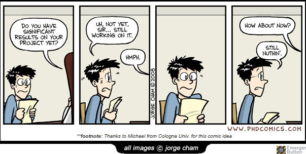
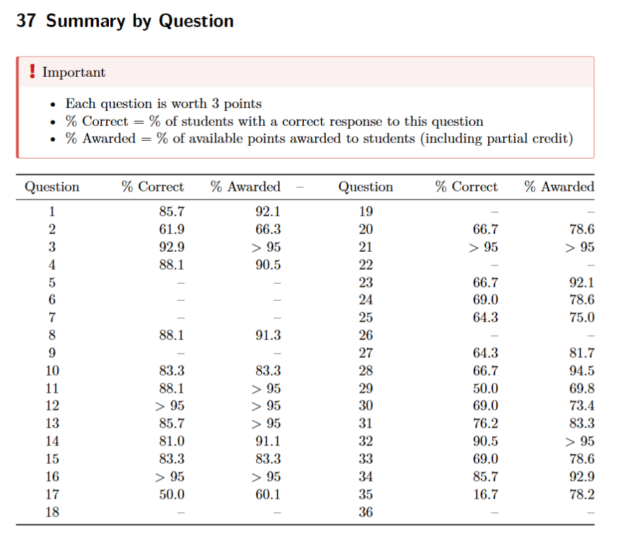

# 431 Class 16: 2026-10-15

[Main Website](https://thomaselove.github.io/431-2026/) | [Calendar](https://thomaselove.github.io/431-2026/calendar.html) | [Syllabus](https://thomaselove.github.io/431-syllabus-2026/) | [Book](https://thomaselove.github.io/431-book/) | [Contact Us](https://thomaselove.github.io/431-2026/contact.html) | [Canvas](https://canvas.case.edu) | [Data and Code](https://github.com/THOMASELOVE/431-data)
:-----------: | :--------------: | :----------: | :---------: | :-------------: | :-----------: | :------------:
for everything | for deadlines | expectations | from Dr. Love | get help | lab submission | for downloads

## Today's Slides

Class | Date | HTML | Word | Quarto | Recording
:---: | :--------: | :------: | :------: | :------: | :-------------:
16 | 2026-10-15 | **[Slides 16](https://thomaselove.github.io/431-slides-2026/class16.html)** | **[Word 16](https://thomaselove.github.io/431-slides-2026/class16w.docx)** | **[Code 16](https://github.com/THOMASELOVE/431-slides-2026/blob/main/class16.qmd)** | Visit [Canvas](https://canvas.case.edu/), select **Zoom** and **Cloud Recordings**

## Announcements

1. Please visit <https://tinyurl.com/431-2026-c16> and complete the very brief survey there **now**.
2. A new version of RStudio (dated 2026-10) is [now available from Posit](https://docs.posit.co/ide/user/download.html). I haven't upgraded yet, but will this weekend. I don't anticipate any problems.
3. We don't have class on Tuesday 2026-10-20 thanks to CWRU Fall Break. TA Office hours are canceled Monday 10-19 and Tuesday 10-20. Our next class is Thursday 2026-10-22.
4. [Project A](https://thomaselove.github.io/431-projectA-2026/), remember, is now due **Monday 2026-10-26 at 9 AM** as is indicated on the [Calendar](https://thomaselove.github.io/431-2026/calendar.html).
    - Remember to [submit all of the elements](https://thomaselove.github.io/431-projectA-2026/#your-deliverables) by that time.
    - Dr. Love will be out of town and unavailable Friday-Sunday before the project is due (2026-10-23 through 2026-10-25) so ask Project questions sooner, rather than later.
    - We'll start talking about Project B in class on 2026-10-27, *AFTER* Project A is done.
5. Today's class uses data from our favorite movies study, specifically the 2026-10-13 version of that data, which contains 97 variables on our 282 movies.
    - You can see the full data on our Shared Drive, and we'll ingest it today using [the googlesheets4 package](https://googlesheets4.tidyverse.org/).
    - The key variables we're studying today include each movie's
        - `imdb_stars`: IMDB stars score (user ratings: 1-10, with 10 being best) from [IMDB](https://www.imdb.com/),
        - `bw_rating`: the [Bechdel-Wallace rating](https://bechdeltest.com/) (which we'll discuss in class, but ranges from 0-3, with 3 = Pass and 0-2 = Fail)
        - `females`: the number of female-presenting roles (0-3) performed by the top three stars, which we'll create in class
        - `rt_audience`: the audience score (popcornometer: 0-100 with 100 being best) from [Rotten Tomatoes](https://www.rottentomatoes.com/)

-------------

## Quiz 1 Grading Update

I hope Quiz 1 went well.

- I will share grades and an answer sketch / rubric with you **via email** when all grades are complete.
- So far, I have graded 27 of the 36 questions for all students, but the questions I haven't yet graded (Q05, Q06, Q07, Q09, Q18, Q19, Q22, Q26 and Q36) required more detailed responses. Here are the results so far.

-------------

## Writing challenges?

- Here's one version of [The 5 Cs](https://edtechbooks.org/rapidwriting/5Cs) by R. Kimmons, focused on "Prioritizing Principles for Good Academic Writing." These 5Cs include Clarity, Cogency, Conventionality, Completeness, and Concision, and explain them in more depth.
- Here's another version of [The 5 Cs](https://academic.oup.com/book/60686/chapter-abstract/526938324?redirectedFrom=fulltext) by Goutham Rao, that might be helpful to you. This chapter introduces readers to a slightly different paradigm for effective scientific writing in the biomedical professions including conciseness, clarity, cogency, commonness, and consistency.
- Many past students have benefited from CWRU's [Writing Resource Center](https://case.edu/writing/resources/writing-resource-center)
    > The Writing Resource Center (WRC) provides support for writers across the university. We offer in-house programming, such as general campus workshops and student/faculty writing groups, and we conduct classroom visits and writing-oriented programs across campus. Our writing consultants provide individualized, hands-on instruction specific to each writer’s goals. We encourage visits from writers at any stage of the writing process, from understanding contexts for writing and interpreting assignment prompts, to organizing and revising ideas. And, we work with all campus writers, including undergraduate students working on course assignments, graduate students working on theses and dissertations, post-doctoral and faculty writers composing grant applications and specialized genres, and staff members working on personal and professional projects. For more information, email us at `writingcenter` at `case` dot `edu`.

-------------

**Remember**: please visit <https://tinyurl.com/431-2026-c16> to complete a very brief survey and get credit for helping today.

------------

## One Last Thing

Across our 282 movies:

- the highest 5 `imdb_stars` scores are:

mov_id | movie | imdb_stars | bw_rating | females | rt_audience
------: | :----------------: | ---------: | -------: | ---------: | -------:
`M-238` | The Shawshank Redemption | 9.3 | 0 (Fail) | 0 | 98
`M-090` | The Godfather | 9.2 | 2 (Fail) | 0 | 98
`M-053` | The Dark Knight | 9.1 | 1 (Fail) | 0 | 94
`M-164` | Lord of the Rings: The Return of the King | 9.0 | 1 (Fail) | 0 | 86
`M-091` | The Godfather, Part II | 9.0 | 1 (Fail) | 0 | 97

- the highest rated (by `imdb_stars`) among movies which pass the Bechdel-Wallace test are:

mov_id | movie | imdb_stars | bw_rating | females | rt_audience
------: | :----------------: | ---------: | -------: | ---------: | -------:
`M-127` | Inception | 8.8 | 3 (Pass) | 1 | 91
`M-163` | Lord of the Rings: The Two Towers | 8.8 | 3 (Pass) | 0 | 95
`M-217` | Pulp Fiction | 8.8 | 3 (Pass) | 1 | 96 
`M-131` | Interstellar | 8.7 | 3 (Pass) | 2 | 86
`M-175` | The Matrix | 8.7 | 3 (Pass) | 1 | 85

- the highest 5 `rt_audience` scores among all 282 movies are:

mov_id | movie | imdb_stars | bw_rating | females | rt_audience
------: | :----------------: | ---------: | -------: | ---------: | -------:
`M-146` | KPop Demon Hunters | 7.4 | 3 (Pass) | 3 | 99
`M-090` | The Godfather | 9.2 | 2 (Fail) | 0 | 98
`M-238` | The Shawshank Redemption | 9.3 | 0 (Fail) | 0 | 98
`M-091` | The Godfather, Part II | 9.0 | 1 (Fail) | 3 | 97
`M-217` | Pulp Fiction | 8.8 | 3 (Pass) | 1 | 96 

- Dr. Love has seen all of these movies, except for KPop Demon Hunters.
- The five lowest rated (by `imdb_stars`) among all 282 movies are:

mov_id | movie | imdb_stars | bw_rating | females | rt_audience
------: | :----------------: | ---------: | -------: | ---------: | -------:
`M-086` | The Gingerdead Man | 3.4 | NA | 1 | 28
`M-230` | The Room | 3.6 | 3 (Pass) | 1 | 47
`M-168` | Madea Goes To Jail | 4.7 | 0 (Fail) | 1 | 96
`M-044` | Chinese Doctors | 4.8 | NA | 1 | NA
`M-063` | Doom | 5.2 | 1 (Fail) | 1 | 34

- Dr. Love has seen "The Room" (sort of - he watched [RiffTrax riff it](https://www.rifftrax.com/the-room-2016)) but that's the only one on this list.
