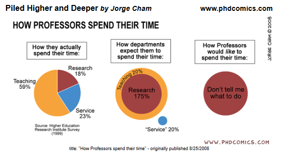

# 431 Class 17: 2026-10-22

[Main Website](https://thomaselove.github.io/431-2026/) | [Calendar](https://thomaselove.github.io/431-2026/calendar.html) | [Syllabus](https://thomaselove.github.io/431-syllabus-2026/) | [Book](https://thomaselove.github.io/431-book/) | [Contact Us](https://thomaselove.github.io/431-2026/contact.html) | [Canvas](https://canvas.case.edu) | [Data and Code](https://github.com/THOMASELOVE/431-data)
:-----------: | :--------------: | :----------: | :---------: | :-------------: | :-----------: | :------------:
for everything | for deadlines | expectations | from Dr. Love | get help | lab submission | for downloads

## Today's Slides

Class | Date | HTML | Word | Quarto | Recording
:---: | :--------: | :------: | :------: | :------: | :-------------:
17 | 2026-10-22 | **[Slides 17](https://thomaselove.github.io/431-slides-2026/class17.html)** | **[Word 17](https://thomaselove.github.io/431-slides-2026/class17w.docx)** | **[Code 17](https://github.com/THOMASELOVE/431-slides-2026/blob/main/class17.qmd)** | Visit [Canvas](https://canvas.case.edu/), select **Zoom** and **Cloud Recordings**

## Announcements

1. Nothing is due until Monday. The next Minute Paper is after Class 18.
2. The [Quiz 1](https://github.com/THOMASELOVE/431-quiz-2026) answer sketch and grading rubric is posted to our Shared Drive.
    - You should have an email from me providing details on your Quiz 1 grade, as well. 
    - A student explained why some of you came up with a particular incorrect response to Question 30. The sketch reflects this, as of Monday night.
    - I will accept Quiz 1 grading revision questions through Monday 2026-10-26 at 9 AM. Just send them to 431-help at case dot edu.
3. [Lab 5](https://github.com/THOMASELOVE/431-labs-2026/tree/main/lab5) involves building a personal website.
    - Please get started as soon as you complete Project A (if not sooner). The Lab is due Wednesday 2026-11-04 at noon.
    - There is **absolutely nothing wrong** with using AI to do [Lab 5](https://github.com/THOMASELOVE/431-labs-2026/tree/main/lab5), from my perspective, **so long as** in your email to me, you tell me precisely what tools **and** what prompts you used to do all of the work.
4. By next week, you should have read Spiegelhalter Chapters 1-3, 5 and 7-11. We'll finish the book by the end of November.
5. I've added a tab called *Attendance* to our Grade Roster on the Shared Drive.
    - The class expectation is that you will [miss no more than four in-person classes during the semester](https://thomaselove.github.io/431-syllabus-2026/12_policies.html#attendance). Missing more than four classes in the situations where I take attendance doesn't lead to a direct penalty in your grade, but it enormously reduces your opportunity to earn [bonus credit](https://thomaselove.github.io/431-syllabus-2026/11_grading.html#bonus-points) for class participation.
    - If you need to miss a class session, or even two, there is no need to contact us. Just review the materials and move on, and please feel encouraged to ask for help.
    - If you must miss **more than two** classes in a row, then it is your responsibility to email Professor Love as soon as possible to let him know. An appropriate email would read “I am unable to attend class on [specific dates] and I will complete all necessary work while I am away.” No additional explanation is required.

## Some Thoughts on Project A

### Reminders

[Project A](https://thomaselove.github.io/431-projectA-2026/) is due at 9 AM on Monday 2026-10-26. By that time, students must submit:

1. Their data, as an R data set, submitted to Canvas
2. Their Quarto file, submitted to Canvas
3. The HTML file generated by rendering their Quarto file, submitted to Canvas
4. Their highlight video, submitted to Canvas
5. The [self-evaluation Google Form](https://tinyurl.com/431-projectA-self-eval-2026), submitted after all other elements are on Canvas

**Submission** Note that if a team is working together as partners on the project, one member of the team must submit items 1-4 above, and the other must submit a Word or PDF document to Canvas stating who their partner is and that their partner will submit the materials for their project team. **Everyone** (including both members of each team) must submit the self-evaluation form individually. 

- I will contact via email any students who have failed to submit all five elements by the deadline. Late work will be met with harsh penalties.
- All students with complete submissions will receive an email from Dr. Love stating that we have all necessary information by Monday 2026-10-26 at noon. **Please watch your email on Monday morning 2026-10-26**.

### How will we grade the project? What last-minute tips do you have for us?

I built [this document](https://docs.google.com/document/d/1EVR333FZDqSQ46qTK1noHO49pCzXLNdR3N2Sj2-ziME) and placed it in our Shared Drive to tell you about how we will grade Project A, and I've tried to provide detailed reminders. 

Here, in the meantime, are key thoughts on three areas of common concern I want to emphasize in class today.

1. Students are **strongly** encouraged to review the [Report Checklist Before Submission](https://thomaselove.github.io/431-projectA-2026/#report-checklist-before-submission) before submitting their Project A **report**.
    - In the YAML, sections 1-9 and sections 16-17, we will be ensuring that you’ve done things correctly, and that your work meets the [requirements from the instructions](https://thomaselove.github.io/431-projectA-2026/#the-project-a-template).
    - Do not add new sections to the template, and do not change the main section headings (1-17) in the template.
    - Make sure that your table of contents functions correctly and shows exactly the 17 headings in the template.
    - Spell-check your work, carefully, and make sure that all of your output is easy to read in your HTML report before submitting it to us.
    - Dr. Love will review the YAML and sections 1-9, essentially to ensure that [any issues left over from the Project A check-in are now appropriately resolved](https://drive.google.com/file/d/1RBKl0Zzq7dEhwhkmp1E2MHZK-wnGA3bK/).

2. **Research Questions** is an area where people often struggle.
    - Each of the four comparisons requires a research question, which should meet [all of the requirements specified here in the Project A instructions](https://thomaselove.github.io/431-projectA-2026/#analyzing-the-data).
    - A strong *exploratory* research question (such as we'd need in Comparisons 1 and 2) and a strong *inferential* research question (such as we'd need in Comparisons 3 and 4) would avoid using yes/no framing, vague language, and causal language. It would also avoid the notion of statistical significance (or synonyms for that concept) entirely.
    - Please stick to the original study aims and specified variables. Rather than introducing new elements, reverse-engineer your research questions directly from the required analyses.
    - Direct use of the sample research questions I have provided will lead you to at best a score of Good on an Excellent to Fair (we don't give Poor as a score) scale on the Project. One way to create a better version would be to provide more precise information about the comparison. That's not the only way to improve on the examples I have provided.
    - An example of a dull but moderately effective and minimally appropriate Comparison 1 research question might be: How do the distributions of [outcome] compare across the [groups under study]?
    - An example of a dull but moderately effective and minimally appropriate Comparison 2 research question might be: Is there a linear relationship between [variable 1] and [variable 2]?
    - Comparisons 3 and 4 have sample research questions associated with them in the instructions.
    - Note the need to specify (at the start) and then reflect on (in the results paragraph) your pre-existing belief about what would happen in Comparisons 3 and 4. Don't skip that.

3. Be sure that you make good choices about what to include in your **video**.
    - To be acceptable, your video needs to be between 2 minutes and 30 seconds and 3 minutes and 15 seconds in length, and we need to see you (at least at the start), see your slides or other materials clearly throughout, and hear you clearly throughout.
    - For each comparison, I would certainly include any decisions you made about dealing with missing data (in any comparison), considering transformations (especially in comparison 2), and about thinking through the assumptions behind any procedure you apply to your data (especially in comparisons 3 and 4).
    - In the video and in the report, you will do better if you focus your response on relevant point estimates and confidence intervals in comparisons 3 and 4, rather than p values.
    - There is no reason to discuss statistical significance or to use the word significance or any synonym for it anywhere in Project A.
    - In the video and in the report, you may pretend (for comparisons 3 and 4, at least) that your data are a representative sample of counties in the US, even though they were not drawn at random, to justify your interpretation of confidence intervals. Just make sure you state this as a limitation when asked to do so.

### What if I have questions about Project A between 5 PM today and the project deadline at 9 AM Monday?

Dr. Love will be away from his computer for all of that time. I suggest you attend [TA office hours](https://thomaselove.github.io/431-2026/contact.html#ta-office-hours) and ask there, or ask at 431-help if you cannot make it to office hours, in the hope that a TA will catch your question and respond.

---------------

## References related to Multiple Imputation and Today's Slides

- Sterne JAC et al [Multiple imputation for missing data in epidemiological and clinical research: potential and pitfalls](https://www.bmj.com/content/338/bmj.b2393) BMJ 2009; 338:b2393.
- [Flexible Imputation of Missing Data, 2nd edition](https://stefvanbuuren.name/fimd/) by Stef Van Buuren
- The mice (Multivariate Imputation by Chained Equations) package [reference page](https://amices.org/mice/).
    - Stef van Buuren, Karin Groothuis-Oudshoorn (2011). [mice: Multivariate Imputation by Chained Equations in R](https://www.jstatsoft.org/article/view/v045i03). Journal of Statistical Software, 45(3), 1-67. DOI 10.18637/jss.v045.i03.
- Heymans MW and Eekhout I [Applied Missing Data Analysis with SPSS and RStudio](https://bookdown.org/mwheymans/bookmi/)
- The `mipo` (Multiple Imputation pooled object) help file [can be found here](https://rdrr.io/cran/mice/man/mipo.html).
- [Getting Started with Multiple Imputation in R](https://library.virginia.edu/data/articles/getting-started-with-multiple-imputation-in-r)
- [Multiple Imputation with the mice package](https://rmisstastic.netlify.app/tutorials/erler_course_multipleimputation_2018/erler_practical_mice_2018)

## The gt package

- <https://gt.rstudio.com/> is the main source for the package

> The gt philosophy: we can construct a wide variety of useful tables with a cohesive set of table parts. These include the table header, the stub, the column labels and spanner column labels, the table body, and the table footer.

## The glue package

- <https://glue.tidyverse.org/> is the main place to go for more information

----------------

## One Last Thing

- Rows: How is Quiz 1 going (as of Class 15 mini-survey)?
- Columns: Which response includes your best guess as to your Quiz 1 points (out of 108) (estimated in Class 16 mini-survey)?
    - 76-85 points out of 108 would be a Quiz 1 score of 70% to 79%; 86-95 points out of 108 is 80% to 88%; 96-108 points is 89% to 100%

-- | 76-85 | 86-95 | 96-108 | Total
:----: | :--: | :--: | :--: | --:
Poor | 1 | 1 | -- | 2
Fair | 4 | 3 | -- | 7
Good | 5 | 10 | 2 | 17
Very Good | 1 | 7 | 1 | 9
Excellent | -- | 1 | -- | 1
Total | 11 | 22 | 3 | 36

The percentage of these 36 students who thought they were in each category was:

- 30.5% in the 70-79% range, 61% in the 80-88% range, and 8.3% in the 89-100% range.

The actual percentage of students in each category (including all 42 students, not just the 36 who answered these two mini-surveys) was:

- 24% in the 70-79% range, 21% in the 80-88% range, and 40% in the 89-100% range, with the rest below 70%.

