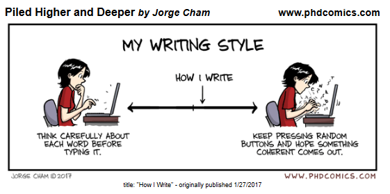

# 431 Class 19: 2026-10-29

[Main Website](https://thomaselove.github.io/431-2026/) | [Calendar](https://thomaselove.github.io/431-2026/calendar.html) | [Syllabus](https://thomaselove.github.io/431-syllabus-2026/) | [Book](https://thomaselove.github.io/431-book/) | [Contact Us](https://thomaselove.github.io/431-2026/contact.html) | [Canvas](https://canvas.case.edu) | [Data and Code](https://github.com/THOMASELOVE/431-data)
:-----------: | :--------------: | :----------: | :---------: | :-------------: | :-----------: | :------------:
for everything | for deadlines | expectations | from Dr. Love | get help | lab submission | for downloads

## Today's Slides

Class | Date | HTML | Word | Quarto | Recording
:---: | :--------: | :------: | :------: | :------: | :-------------:
19 | 2026-10-29 | **[Slides 19](https://thomaselove.github.io/431-slides-2026/class19.html)** | **[Word 19](https://thomaselove.github.io/431-slides-2026/class19w.docx)** | **[Code 19](https://github.com/THOMASELOVE/431-slides-2026/blob/main/class19.qmd)** | Visit [Canvas](https://canvas.case.edu/), select **Zoom** and **Cloud Recordings**

## Announcements

1. A list of "Good Books" [responding to this](https://thomaselove.github.io/431-projectA-2026/#section-14.-reflection) that you read for fun and enjoyed is now available on our Shared Drive, and linked at <https://tinyurl.com/431-2026-good-books>. The 41st book listed is one I've read recently and enjoyed.
2. Feedback on the Minute Paper after Class 18 will be posted **by class time**.

## Reminders

1. We do not have 431 class next Tuesday, thanks to Election Day. 
        - As far as I know, all other CWRU classes are still on for that day, and the TAs will hold office hours.
2. [Lab 5](https://github.com/THOMASELOVE/431-labs-2026/tree/main/lab5) involves building a personal website, and is due Wednesday 2026-11-04 at noon.
        - There is **absolutely nothing wrong** with using AI to do [Lab 5](https://github.com/THOMASELOVE/431-labs-2026/tree/main/lab5), from my perspective, **so long as** in your email to me, you tell me precisely what tools **and** what prompts you used to do all of the work.
3. I am giving a talk on Friday 2026-10-30 from 9 to 10 AM in room R219 on the second floor of the Rammelkamp building at MetroHealth Medical Center (2500 MetroHealth Dr, Cleveland 44109), entitled "[The Power, Peril and Pervasiveness of Artificial Intelligence](https://github.com/THOMASELOVE/431-classes-2026/blob/main/class18/Love_seminar_PHRI_2026-10-30.pdf)." 
        - The [seminar flyer found here (pdf)](https://github.com/THOMASELOVE/431-classes-2026/blob/main/class18/Love_seminar_PHRI_2026-10-30.pdf) includes Zoom and in-person attendance information, as well as an abstract.
4. The [Project B registration form](https://thomaselove.github.io/431-projectB-2026/register.html) is due at 9 AM **Saturday 2026-11-07**.
      - Start by reading the Project B instructions, found at <https://thomaselove.github.io/431-projectB-2026/>.

